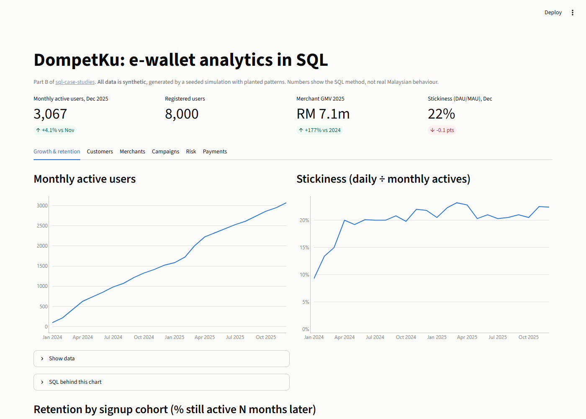
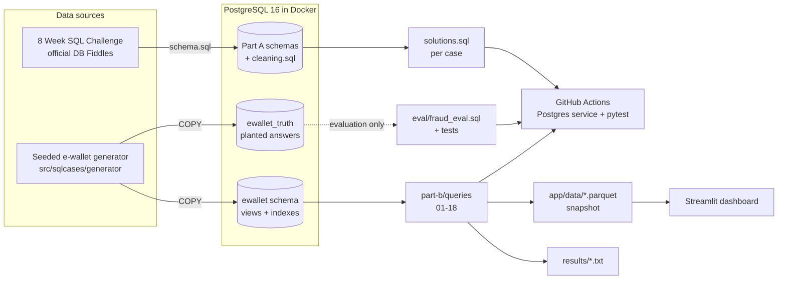

# sql-case-studies

**PostgreSQL case studies for a data analyst portfolio:** four 8 Week SQL Challenge cases solved from scratch, plus a custom
Malaysian e-wallet case with 18 business questions, campaign measurement, a fraud-lite rule and an indexing benchmark.

**Live demo:** [dompetku-sql-case-studies.streamlit.app](https://dompetku-sql-case-studies.streamlit.app) (Part B dashboard, synthetic data)
Every query is tested in CI.

[](https://github.com/zeeqy/sql-case-studies/actions/workflows/ci.yml)
· **Live dashboard:** _link added after deploying on Streamlit Community Cloud_



## Why this exists
SQL is the skill data analyst interviews test most. This repo shows it on two kinds of problem:
- **Part A:** well-known practice cases, answered with my own SQL and a short write-up of insights per case.
- **Part B:** a realistic fintech dataset I built myself, so I could ask harder questions and *check* the answers
  against a known truth. Examples: did a cashback campaign work, and does a fraud rule catch what it should?

## What's inside
| Part | Case | Highlights |
|---|---|---|
| A | [Danny's Diner](part-a/01-dannys-diner) | joins, `DENSE_RANK` ties, conditional loyalty points |
| A | [Pizza Runner](part-a/02-pizza-runner) | a cleaning layer for messy data (text `'null'`s, units in numbers), arrays, `LATERAL unnest` |
| A | [Foodie-Fi](part-a/03-foodie-fi) | churn and journeys with `LAG`/`LEAD`; a 2020 **payments table built from billing rules** |
| A | [Data Bank](part-a/04-data-bank) (fintech) | data-quality findings, **gaps-and-islands**, daily balance spine, recursive compound interest, a decision table |
| B | [DompetKu e-wallet](part-b) (custom) | 18 questions: MAU, cohorts, RFM, merchants by state, **difference-in-differences** campaign uplift, a **mule-detection rule** scored against truth, `EXPLAIN ANALYZE` with B-tree/partial/BRIN indexes |

Plus [CHEATSHEET.md](CHEATSHEET.md), the SQL patterns used here for interview revision, and [LEARN.md](LEARN.md).

## Data
- **Part A:** schemas and data from [8 Week SQL Challenge](https://8weeksqlchallenge.com) by Danny Ma (cases 1–4), taken from the
  official DB Fiddles. Row counts are checked in tests. Questions are reworded, and all solutions are my own.
- **Part B:** **synthetic**. A seeded Python simulation of a Malaysian e-wallet: 8,000 users across 16 states, 569 merchants
  with real MCC codes, 6 cashback campaigns, and about 382k MYR transactions (2024–2025). Patterns are planted
  deliberately (trends, campaign effects, mule accounts and look-alike decoys), and the "answers" sit in a separate schema
  that only evaluation code reads. Details: [part-b/DATA.md](part-b/DATA.md).

## Key findings (Part B)
- **Naive before/after comparisons overstate cashback campaigns by up to 2×.** User growth and Raya/11.11 seasonality ride along.
  Difference-in-differences recovers the planted effect closely for 3 of 4 targeted campaigns (e.g. 1.24× vs true 1.25×).
  It misses a 5-day flash sale, and the write-up says so.
- **No campaign pays back on merchant fees alone.** The worst costs RM71 per RM100 of extra spend, and 90% of its cashback went
  on spend that would have happened anyway.
- **Combining signals beats any single signal:** "burst of round transfers" flags 65 wallets at 20% precision; adding
  "money passed on within 30 minutes" flags the 13 planted mules at 100%. That's only possible because the pattern was planted.
- **Champions are 23% of wallets but 57% of spend.** Full-KYC bill payers churn least (41% vs 74%).
- **Indexes are not magic:** one wallet's statement goes from 26.8 ms to 0.2 ms (BitmapOr of two indexes); a full-history
  aggregate doesn't move (1.0×), because a sequential scan is already the right plan.

More in each case README and [part-b/README.md](part-b/README.md).

## Architecture


## Stack
PostgreSQL 16 (Docker) · Python 3.12 with uv · psycopg 3 · numpy (generator) · Streamlit + Plotly (dashboard) · pytest + ruff ·
GitHub Actions

## How to run
Needs Docker Desktop and [uv](https://docs.astral.sh/uv/).
```bash
uv sync
uv run sqlcases up          # start Postgres (port 54432, or $DB_PORT) and load every case (~1 min)
uv run sqlcases psql        # explore in psql, e.g.  SET search_path = ewallet;
uv run sqlcases results     # re-run all Part B queries into part-b/results/
uv run sqlcases explain     # EXPLAIN ANALYZE before/after indexes
uv run sqlcases snapshot    # refresh the dashboard data
uv run streamlit run app/streamlit_app.py
uv run pytest -q            # 46 tests (needs the database up)
uv run sqlcases down -v     # stop and delete the data volume
```
Settings are in `.env.example` (local-only defaults; nothing secret). Port taken? Set `DB_PORT` in `.env` (Windows can reserve ranges: `netsh interface ipv4 show excludedportrange protocol=tcp`). Optional pgAdmin: `uv run sqlcases up --gui`.

## Repo layout
```
part-a/NN-case/       schema.sql, questions.md, solutions.sql, README.md (+ cleaning.sql for Pizza Runner)
part-b/               schema, views, indexes, queries/, results/, eval/, explain/, DATA.md, README.md
src/sqlcases/         CLI, database helpers, generator/, snapshot
app/                  Streamlit dashboard + parquet snapshot
tests/                Part A answers, generator invariants, Part B queries, fraud eval, dashboard
```

## Testing
CI starts Postgres 16, loads everything, and then checks:
- every Part A solution and every Part B query runs and returns rows
- key answers match (e.g. Foodie-Fi 2020 revenue, Data Bank balances)
- the generator is reproducible and wallets never go negative
- the fraud rule beats the naive rule against the planted truth
- the dashboard renders
- the committed outputs match a fresh run

## Limitations
- Part B is synthetic. It shows the SQL and the analysis method, not real Malaysian e-wallet behaviour.
- One generator seed, so there are no confidence intervals on the campaign estimates.
- ~382k rows is small for performance work. The index lessons hold, but production tables would also need partitioning.
- The 8 Week SQL Challenge cases are popular practice problems. Their value here is in the explanations, cleaning and checks,
  not in novelty.
